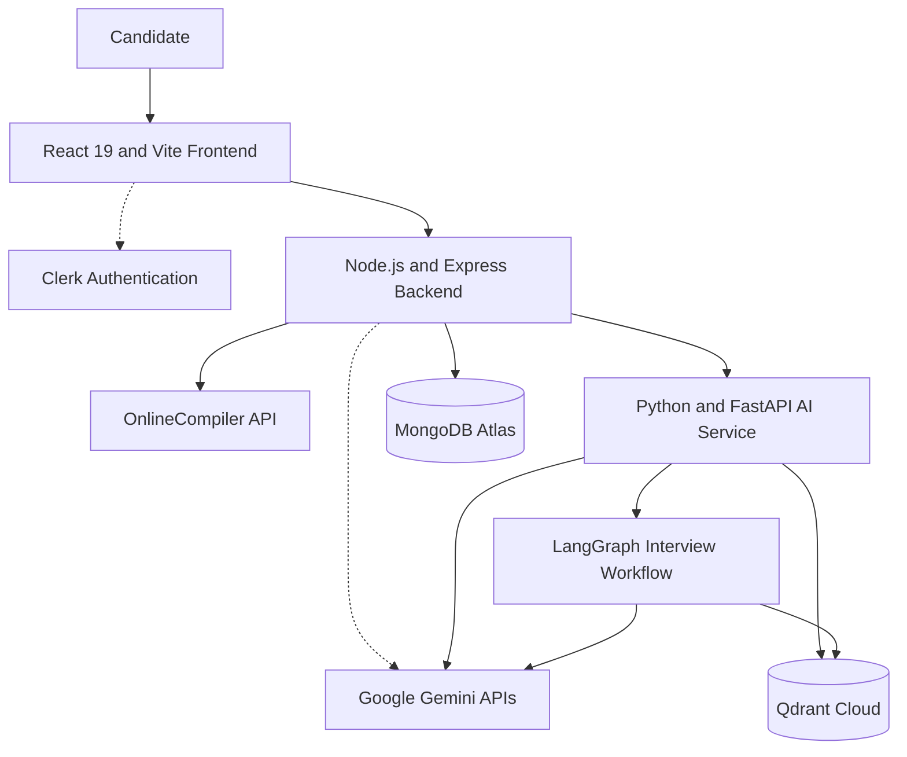
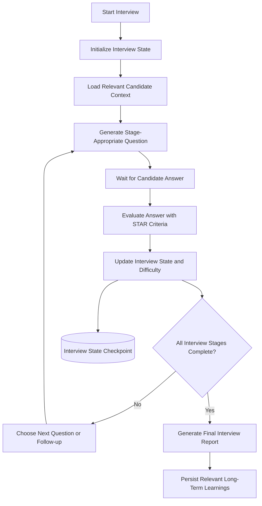
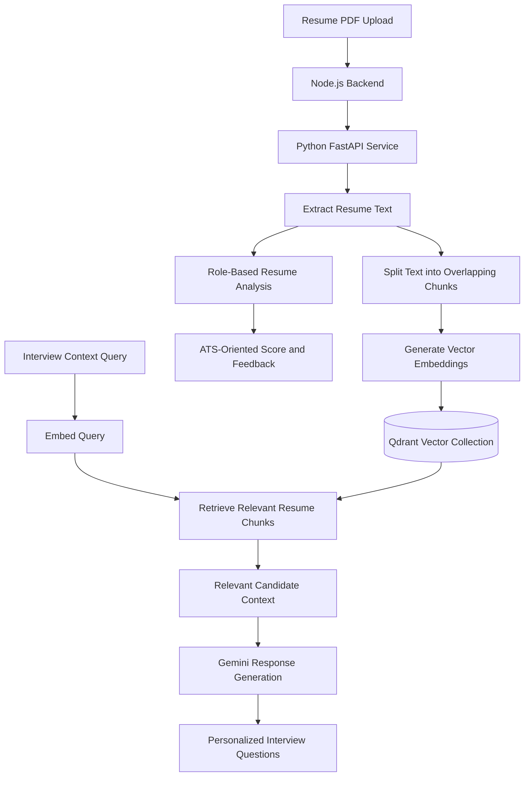

# 🚀 PrepAI 2.0 — AI-Powered Interview Preparation Platform

PrepAI 2.0 is a full-stack AI-powered platform that helps software engineering candidates prepare for technical and behavioral interviews through coding practice, personalized interview simulations, resume analysis, and adaptive learning.

The platform combines a React frontend, a Node.js and Express application backend, and a Python/FastAPI AI service. LangGraph orchestrates stateful interview workflows, Gemini powers AI-driven features, MongoDB Atlas stores application data, and Qdrant supports semantic retrieval of resume information.

Rather than treating interview preparation as a collection of disconnected AI prompts, PrepAI brings coding practice, contextual interview coaching, resume feedback, and learning progress into one application.

**Live application:** [prepai-app.vercel.app](https://prepai-app.vercel.app/)

## Table of Contents

- [Features](#-features)
- [Architecture](#-architecture)
- [How It Works](#-how-it-works)
- [Technology Stack](#-technology-stack)
- [Engineering Decisions](#-engineering-decisions)
- [Repository Structure](#-repository-structure)
- [Getting Started](#-getting-started)
- [Environment Configuration](#-environment-configuration)
- [Testing](#-testing)
- [Deployment](#-deployment)
- [Security and Reliability](#-security-and-reliability)
- [Project Status and Roadmap](#-project-status-and-roadmap)
- [Contributing](#-contributing)
- [Author](#-author)

---

## ✨ Features

### 1. 🔢 DSA Arena and Code Execution Engine

Practice data structures and algorithms in an interactive coding environment with AI-assisted problem generation, remote code execution, and detailed feedback.

#### Multi-language code editor

- Supports JavaScript (Node.js), Python 3, Java, and C++.
- Uses CodeMirror for syntax highlighting, line numbers, code folding, and bracket matching.
- Includes a client-side code-formatting workflow for supported languages.
- Provides problem, editor, and feedback panels for the coding workflow.

#### Remote code execution and evaluation

PrepAI uses the configured **OnlineCompiler API** to execute submitted code instead of implementing its own language runtime.

- **Run Code:** Execute solutions against visible sample test cases for quick debugging.
- **Submit Code:** Evaluate solutions against hidden test cases managed by the backend.
- Persist formal verdicts and submission statistics in MongoDB where configured.
- Normalize supported output values to reduce false negatives caused by formatting or serialization differences.
- Report execution time and memory information when provided by the execution service.
- Combine execution results with AI-generated time and space complexity feedback.

#### AI problem generation and validation

AI-generated coding challenges can be inconsistent, so PrepAI includes validation and recovery mechanisms.

- Generate problems based on topic, difficulty, and supported criteria.
- Validate generated problems against their reference solutions and test cases.
- Attempt constrained repair when a generated reference solution fails validation.
- Fall back to curated, pre-verified problem blueprints when repair fails.

The aim is to avoid presenting every AI-generated problem as correct without verification.

#### 🤖 Pepe AI DSA Coach

PrepAI includes a conversational Pepe AI Coach integrated directly into the DSA Arena, helping users learn concepts, generate coding problems, and improve their problem-solving skills without leaving the coding workspace.

- **Chat-Based Problem Generation:** Ask Pepe to generate DSA problems through chat based on a requested topic or practice need.
- **Progressive Hints:** Request hints step by step to discover the solution approach without immediately revealing the complete answer.
- **Concept Clarification:** Discuss data structures, algorithms, and problem-solving techniques to strengthen conceptual understanding.
- **Problem-Solving Guidance:** Get assistance with understanding problem statements, exploring solution approaches, and analyzing edge cases.
- **Personalized Practice:** Focus on weaker topics and request practice aligned with individual learning goals.
- **Study Plan Management:** Create or update a study plan and review the existing plan directly through the coaching interface.

The Pepe AI DSA Coach complements the CodeMirror editor, OnlineCompiler-powered code execution, and AI-assisted evaluation. It supports conversational learning and guided problem-solving, while code execution and formal submission handle testing and grading separately.

### 2. 💬 Pepe Behavioral Interview Coach

Practice structured interviews with Pepe, PrepAI's AI coach.

#### Stateful, multi-stage interviews

- Conduct a structured interview across approximately four to five stages.
- Cover introductions, technical and professional fundamentals, applied problem-solving, situational or behavioral questions, and wrap-up.
- Maintain workflow state across multiple questions and candidate responses.
- Use LangGraph to coordinate interview stages, evaluate answers, and choose the next transition.
- Pause the workflow while waiting for a candidate response and resume it when the answer is submitted.

#### STAR-based answer evaluation

Evaluate behavioral answers using the STAR framework:

- **Situation:** What was happening?
- **Task:** What responsibility or challenge did the candidate have?
- **Action:** What did the candidate do?
- **Result:** What outcome followed?

Feedback can include granular scores, missing details, suggested improvements, and areas to develop.

#### Adaptive interview difficulty

The interview workflow can adjust question difficulty according to the candidate's performance and current interview state.

- Choose an appropriate level of difficulty: Easy, Medium, or Hard.
- Use previous responses and evaluation results to guide subsequent questions.
- Ask follow-up questions or adjust the challenge level when the workflow determines that more or less difficulty is appropriate.
- Maintain stage progression instead of relying entirely on a single, unstructured conversation prompt.

#### Final interview report

At the end of a completed interview, generate a consolidated evaluation covering areas such as:

- Communication clarity.
- Ownership and decision-making.
- Problem-solving approach.
- Strengths and improvement areas.
- Recommended preparation priorities.

#### Voice and audio experience

The Coach includes browser-based speech and audio features.

- Web Audio API waveform visualization that responds to microphone input.
- Audio visualization that settles when the microphone is quiet.
- Speech-to-text support with transcript accumulation to preserve earlier recognized text when speech recognition pauses.
- Browser-provided speech synthesis voices, with voice selection adapted to the available platform voices.
- Animated Pepe expressions and speech-related visual feedback where supported.

Available voices depend on the browser and operating system.

### 3. 📄 Resume Reviewer and Role-Based ATS Feedback

Analyze a resume against a candidate's intended role and provide actionable feedback.

#### Resume analysis

- Upload resumes in PDF format.
- Extract text from multi-page documents.
- Review resume content for clarity, action verbs, and measurable achievements.
- Evaluate how effectively the candidate communicates projects, skills, experience, and impact.
- Produce an ATS-oriented score and recommendations through the configured AI review workflow.

#### Role-based feedback

Use the selected target role to focus feedback on relevant skills and experience.

The goal is to identify gaps between the resume and the expectations of the intended role, instead of giving every candidate the same generic recommendations.

ATS scores are AI-generated estimates, not guarantees of how a particular employer's applicant tracking system will rank a resume.

#### Resume RAG pipeline

Resume content can also be indexed for semantic retrieval, allowing the interview workflow to retrieve relevant projects and technical skills when generating personalized questions.

- Extract and chunk resume text.
- Generate vector embeddings.
- Index chunks in Qdrant.
- Associate vectors with document identifiers.
- Retrieve relevant chunks for contextual interview generation.

### 4. 🧠 Adaptive Intelligence and Persistent Memory

PrepAI supports adaptive practice at both the coding and interview levels.

#### Adaptive DSA difficulty

- Track coding performance and submission outcomes.
- Use streaks, attempts, and hint usage where available.
- Increase difficulty after sustained success.
- Provide easier challenges or additional guidance when a candidate struggles.
- Avoid repeatedly serving the same problem during a study session.

A bounded in-memory session cache can track recently used problem blueprints, topics, and titles to reduce repetition.

#### Cross-session memory

Useful candidate information can be retained for later sessions.

Examples include:

- Weak DSA topics.
- Previous interview answers and scores.
- Recurring communication or problem-solving weaknesses.
- Preferred technologies and areas of interest.

Long-term user memory is stored in MongoDB where implemented, while the interview workflow uses its own state and checkpointing mechanism.

At a new interview, relevant memories can be retrieved and included in the context. The intention is to retrieve useful information rather than send every stored memory to the model on every request.

### 5. 🏢 Company-Specific DSA Question Catalog

PrepAI maintains a catalog of company-tagged coding questions sourced from community-maintained repositories.

Source repositories:

- [leetcode-companywise-interview-questions](https://github.com/snehasishroy/leetcode-companywise-interview-questions)
- [leetcode-company-wise-problems](https://github.com/liquidslr/leetcode-company-wise-problems)

#### Catalog ingestion and synchronization

- Import public question metadata from configured sources.
- Normalize company aliases, problem URLs, and slugs.
- Deduplicate records using a canonical problem/company key.
- Store catalog records in MongoDB.
- Track synchronization outcomes and failures where configured.
- Use a scheduled GitHub Actions workflow for recurring synchronization.

#### Finding relevant questions

- Filter questions by company and frequency tier.
- Retrieve relevant company questions through the backend.
- Provide links to the original problem pages.
- Attribute community sources appropriately.

The upstream repositories are community-maintained and are not official LeetCode datasets. Review their licensing terms before redistributing their data or content.

### 6. 📊 Dashboard, Analytics, and Learning Progress

PrepAI provides a dashboard for tracking preparation activity and reviewing progress.

- **Activity heatmap:** Visualize practice activity over time.
- **Daily streaks:** Encourage consistent preparation.
- **Topic and difficulty breakdown:** Review coding performance across areas such as arrays, trees, graphs, and dynamic programming.
- **Performance charts:** Display relevant practice metrics using Recharts.
- **Personalized study plans:** Generate structured plans based on target roles, experience levels, and interview timelines where supported.
- **Recent submissions:** Review past code submissions, verdicts, execution statistics, and code history where available.

These features help candidates understand what they have practiced and where additional preparation may be useful.

### 7. 🎨 UI, Pepe Mascot, and Theming

PrepAI includes a dark interface with emerald and cyan accents, a custom Pepe mascot, and personalization options.

#### Animated Pepe robot

- SVG-based mascot rendering.
- Reactive facial states such as thinking, happy, celebrating, and speaking where supported.
- Reusable mascot assets across the Coach interface and floating widget.
- Voice-related visual feedback.

#### Wallpaper personalization

- Eight curated wallpaper choices: Morning Lake, Aurora Night, Snow Peak, Misty Forest, Moonlight Serenade, Dreamy Horizon, Cosmic Nebula, and Dark Abstract.
- Support for uploading custom wallpapers.
- Custom images stored in client-side IndexedDB.
- Separate tracking of the active wallpaper and the saved custom wallpaper preview.
- Account-scoped settings based on Clerk user identity where configured.
- Object URL lifecycle management to avoid unnecessary browser memory usage.

#### Responsive interface

- Mobile navigation and touch-friendly controls.
- Floating Coach positioning designed to handle mobile viewport changes.
- Responsive coding, coaching, resume, dashboard, and settings pages.
- A customized Clerk sign-in appearance with PrepAI branding.

### 8. 🛡️ Infrastructure, Reliability, and Security

#### Three-service architecture

The application separates the frontend, application backend, and AI workflows:

- React and Vite frontend.
- Node.js and Express application backend.
- Python and FastAPI AI service.

#### Service-to-service security

- The Node.js backend calls the Python AI service through a configured service URL.
- Protected service requests use the `x-internal-service-key` header.
- A shared secret is configured on the server side and must never be exposed to the frontend.

#### Gemini quota handling

The project includes a configured Gemini failover path for supported quota-exhaustion cases.

Where enabled, the implementation can recognize certain primary-project quota failures and use a configured fallback project after a cooldown. The exact failure conditions depend on the implemented classifier and service configuration.

#### Backend reliability

- Timeout handling for requests to the AI service.
- More structured error propagation and diagnostics for upstream failures.
- Multi-tier rate limiting for selected API categories.
- Request deduplication and short-lived caching for eligible frontend API calls.
- User-scoped cache keys where configured.
- Credential redaction in relevant logs and scripts.
- Windows DNS-resolution handling for MongoDB Atlas SRV lookups.

These mechanisms improve diagnosability and resilience, but they do not eliminate all service failures or guarantee uninterrupted AI availability.

---

## 🏗️ Architecture

PrepAI 2.0 separates the application interface, backend business logic, and AI workflow execution.

### High-level architecture



The diagram shows the logical service boundaries. The precise path varies by feature: application operations are handled by the backend, while AI workflows and vector retrieval are delegated to the services responsible for those tasks.

### Behavioral interview workflow



LangGraph coordinates state, transitions, and resumable interview steps. Gemini handles the language-model operations. Candidate memory and workflow checkpoint state serve different purposes: long-term learning context is stored separately from the state required to resume an interview.

### Resume RAG and ATS analysis pipeline



The ATS review and RAG retrieval are related but distinct operations. The review produces resume feedback, while vector retrieval provides relevant candidate context to downstream AI workflows.

---

## 🛠️ Technology Stack

| Layer | Technologies |
|---|---|
| Frontend | React 19, Vite, Tailwind CSS, CodeMirror, Axios |
| Authentication | Clerk |
| Application backend | Node.js, Express, Mongoose |
| Application database | MongoDB Atlas |
| AI service | Python, FastAPI, Uvicorn, Pydantic |
| Workflow orchestration | LangGraph |
| Language model | Google Gemini |
| Vector database | Qdrant Cloud |
| Code execution | OnlineCompiler API |
| Charts and visualizations | Recharts |
| Icons and animation | Lucide, Framer Motion where used |
| Testing | Frontend tests, Node.js regression/integration tests, Python tests |
| Deployment | Vercel and Render |

Package versions can change; the `package.json` files and Python dependency files are the source of truth.

---

## 🧩 Engineering Decisions

### Why separate Node.js and Python?

Node.js and Express retain application routes, authentication integration, user data, coding workflows, and established business logic. Python/FastAPI handles AI-specific processing and workflow execution.

This separation makes it possible to evolve the AI service independently without moving the entire application backend. The trade-off is additional network boundaries, configuration, and cross-service error handling.

### Why LangGraph?

A multi-stage interview needs explicit state and conditional transitions. LangGraph coordinates the interview workflow, manages pauses while waiting for candidate responses, and determines what should happen next.

It does not replace Gemini or the application's business logic.

### Why use RAG?

Resume retrieval lets the application provide relevant evidence from a candidate's resume when generating questions or feedback. It avoids relying solely on generic prompts and can reduce the amount of unrelated context sent to the model.

RAG quality still depends on extraction, chunking, embeddings, and retrieval filters.

### Why use both MongoDB and Qdrant?

MongoDB stores application and structured data. Qdrant stores vectors and supports similarity search.

The application must coordinate identifiers and lifecycle management so that document metadata, user access, and vector records remain consistent.

### Why use an external code execution service?

Running arbitrary user-submitted code requires careful isolation. PrepAI delegates code execution to the configured OnlineCompiler API instead of implementing its own language runtime.

The backend controls the execution workflow and manages formal evaluation. The execution provider, its limits, and its isolation guarantees remain external dependencies.

---

## 📂 Repository Structure

The following tree describes the high-level service layout. Refer to the actual repository for the full file structure.

```text
PrepAI/
├── .github/
│   └── workflows/
│       └── sync-company-questions.yml
├── client/
│   ├── public/
│   ├── src/
│   │   ├── components/
│   │   ├── context/
│   │   ├── pages/
│   │   └── utils/
│   ├── tests/
│   └── package.json
├── server/
│   ├── config/
│   ├── controllers/
│   ├── middleware/
│   ├── models/
│   ├── routes/
│   ├── scripts/
│   ├── services/
│   ├── tests/
│   └── package.json
├── ai-services/
│   ├── app/
│   │   ├── agents/
│   │   ├── core/
│   │   ├── routes/
│   │   ├── schemas/
│   │   └── services/
│   ├── tests/
│   └── requirements.txt
├── docker-compose.yml
└── README.md
```

---

## 🚀 Getting Started

### Prerequisites

- Git.
- Node.js and npm versions compatible with the project.
- Python and pip.
- MongoDB Atlas or another supported MongoDB deployment.
- Qdrant Cloud or a compatible local Qdrant instance.
- A Google Gemini API key.
- Clerk configuration if authentication is enabled.
- OnlineCompiler API credentials if required by the selected execution service.

Docker may be useful for local dependencies where the project provides a Compose configuration.

### 1. Clone the repository

```bash
git clone <YOUR_GITHUB_REPOSITORY_URL>
cd PrepAI
```

Replace the placeholder with your repository's actual URL.

### 2. Run the Python AI service

Open a terminal:

```bash
cd ai-services
python -m venv .venv
```

Activate the environment.

**Windows PowerShell:**

```powershell
.\.venv\Scripts\Activate.ps1
```

**macOS/Linux:**

```bash
source .venv/bin/activate
```

Install dependencies:

```bash
pip install -r requirements.txt
```

Configure the required values using the service's `.env.example`, if provided. Do not commit the resulting `.env` file.

Start the service with the project's configured entry point. The previously used local command is:

```bash
uvicorn app.main:app --reload --port 9000
```

If the health endpoint is enabled, test:

```text
http://localhost:9000/health
```

### 3. Run the Node.js backend

In a separate terminal:

```bash
cd server
npm install
```

Configure the backend's required environment variables.

Start the backend using the script defined in `server/package.json`. If the repository defines the `dev` script:

```bash
npm run dev
```

The backend has commonly used port `5000` in local development. Confirm the active port from the application configuration and startup logs.

### 4. Run the frontend

In another terminal:

```bash
cd client
npm install
npm run dev
```

Open the URL printed by Vite, typically:

```text
http://localhost:5173
```

### Local service connections

Confirm that:

- The frontend API base URL points to the Node.js backend.
- The Node.js backend points to the Python AI service.
- The Node.js and Python service secrets match.
- MongoDB, Qdrant, Gemini, Clerk, and OnlineCompiler credentials are configured where required.
- The configured vector size matches the embedding model used by the AI service.

---

## 🔐 Environment Configuration

Never commit real API keys, database credentials, service secrets, or `.env` files.

The following are variables discussed during development. Check the current configuration code and `.env.example` files to confirm exact names and required status.

| Variable | Service | Purpose |
|---|---|---|
| `VITE_CLERK_PUBLISHABLE_KEY` | Frontend | Public Clerk publishable key |
| `VITE_API_BASE_URL` | Frontend | Base URL for the Node.js API, if configured |
| `VITE_POSTHOG_KEY` | Frontend | Optional analytics project key |
| `VITE_POSTHOG_HOST` | Frontend | Analytics ingestion host |
| `CLERK_PUBLISHABLE_KEY` | Backend | Clerk publishable configuration, if required |
| `CLERK_SECRET_KEY` | Backend | Private Clerk server credential |
| `DATABASE_URL` or `MONGODB_URI` | Backend | MongoDB connection string; use the name actually read by the application |
| `AI_SERVICE_URL` | Backend | Base URL of the Python AI service |
| `AI_SERVICE_SECRET` | Backend and AI service | Shared secret for protected service-to-service requests |
| `AI_SERVICE_TIMEOUT_MS` | Backend | AI request timeout, if configured |
| `GEMINI_API_KEY` | Backend or AI service | Gemini API credential |
| `GEMINI_FALLBACK_API_KEY` | Backend or AI service | Optional fallback credential where implemented |
| `GEMINI_FAILOVER_ENABLED` | Backend or AI service | Enables supported quota failover logic |
| `QDRANT_URL` | AI service | Qdrant endpoint |
| `QDRANT_API_KEY` | AI service | Qdrant credential when required |
| `QDRANT_COLLECTION` | AI service | Vector collection name, if configurable |
| `QDRANT_VECTOR_SIZE` | AI service | Configured vector dimension, if configurable |
| `ONLINECOMPILER_API_KEY` | Backend | Remote code execution API credential, if required |
| `TEST_CASE_ENCRYPTION_KEY` | Backend | Key for hidden test-case protection, if configured |
| `MONGODB_DNS_SERVERS` | Backend | Optional DNS resolver configuration |
| `TRUST_PROXY` | Backend | Express proxy-trust setting, if supported |
| `LANGSMITH_TRACING` | AI service | Optional LangSmith tracing configuration |

**Important configuration rules:**

- Frontend `VITE_` variables are exposed to the browser. Never store private secrets in them.
- Keep backend and AI-service credentials server-side.
- Ensure `AI_SERVICE_SECRET` matches across the two services.
- Use HTTPS for deployed service endpoints.
- Avoid logging API keys, authentication headers, resume text, or private candidate data.

---

## 🧪 Testing

Run tests from the relevant service directory.

### Frontend tests and build

```bash
cd client
npm test
npm run build
```

### Node.js backend tests

```bash
cd server
node tests/run-all-tests.js
```

Use this command if `tests/run-all-tests.js` exists in the current branch; otherwise, follow the scripts in `server/package.json`.

### Python AI-service tests

If the project uses Python's `unittest`:

```bash
cd ai-services
python -m unittest discover tests
```

If the current branch uses pytest instead:

```bash
pytest tests/
```

Use the test framework actually configured by the repository.

### Important test areas

- DSA problem generation, validation, and repair.
- Code execution and formal submission evaluation.
- Interview state transitions and adaptive difficulty.
- Resume extraction, ATS feedback, and vector retrieval.
- Service authentication, timeouts, and upstream failure handling.
- Wallpaper, voice, and mobile UI behavior.

Passing unit tests does not by itself establish complete end-to-end correctness. Verify the workflows against the configured services as well.

---

## 🌐 Deployment

The deployment topology previously configured for PrepAI is:

| Component | Platform |
|---|---|
| React frontend | Vercel |
| Node.js backend | Render |
| Python AI service | Render |
| Application database | MongoDB Atlas |
| Vector database | Qdrant Cloud |

The primary user-facing application is:

- **PrepAI frontend:** https://prepai-app.vercel.app/

The Node.js and Python services have separate deployment URLs configured through environment variables. Their base URLs are service endpoints, not standalone user interfaces, and may return 404 if no root route is implemented.

### Deployment checklist

1. Configure the frontend, backend, and AI-service environment variables independently.
2. Set the frontend API base URL correctly.
3. Set the backend's `AI_SERVICE_URL` to the intended AI-service deployment.
4. Configure matching internal service authentication secrets.
5. Confirm database and vector-store connectivity.
6. Verify health endpoints where implemented.
7. Test coding, interview, resume, and authentication workflows.
8. Review sanitized service logs for timeouts and upstream failures.

Do not put service secrets in the README, source control, or browser environment variables.

---

## 🛡️ Security and Reliability

PrepAI handles user-submitted code and personal resume data, so security and failure handling matter.

- Keep private credentials out of source control.
- Protect application routes with the configured authentication middleware.
- Protect internal AI routes with service authentication.
- Apply appropriate request validation and rate limiting.
- Keep hidden test cases out of the client response.
- Validate uploaded documents and restrict access to candidate data.
- Do not log credentials, sensitive resume content, or authentication headers.
- Use request timeouts and actionable error reporting for upstream AI calls.
- Treat AI-generated code, questions, and evaluations as fallible.

The code execution engine depends on the configured OnlineCompiler service. Its availability, API limits, and isolation guarantees are external dependencies.

A publicly accessible service URL is not a secret and does not replace authentication, authorization, or rate limiting.

---

## 📈 Project Status and Roadmap

PrepAI 2.0 is an evolving project.

### Main implemented areas

- Full-stack React, Node.js, and Python/FastAPI architecture.
- DSA challenge generation and remote code execution.
- Coding problem validation and repair mechanisms.
- Stateful behavioral interview orchestration with LangGraph.
- Role-based resume analysis and RAG-oriented retrieval.
- Adaptive practice and persistent candidate context where configured.
- Company-specific DSA catalog and synchronization workflow.
- Dashboard analytics, study planning, and personalization features.
- Regression tests and service error-handling improvements.

### Potential future improvements

- More comprehensive retrieval and evaluation benchmarks.
- Broader end-to-end testing across the services.
- More detailed learning analytics and interview trend reports.
- Further improvements to voice-based interview interaction.
- System design interview practice.
- Better measurements of AI-generated problem and feedback quality.

Roadmap items may change as implementation and testing progress.

---

## 🤝 Contributing

Contributions, bug reports, and constructive feedback are welcome.

### Contributing workflow

1. Fork the repository.
2. Create a feature branch:

   ```bash
   git checkout -b feature/your-feature-name
   ```

3. Implement a focused change.
4. Run the relevant tests and build checks.
5. Confirm that no credentials or `.env` files are included.
6. Commit with a clear message.
7. Open a pull request describing the problem, solution, and verification steps.

### Contribution guidelines

- Keep changes focused and easy to review.
- Preserve existing API contracts unless changes are intentional and documented.
- Coordinate changes that affect communication between Node.js and Python.
- Add regression tests for bug fixes where practical.
- Document non-obvious architectural decisions.
- Never commit credentials or private candidate data.

For bug reports, include reproduction steps, expected and actual behavior, and relevant sanitized logs.

---

## 👤 Author

Developed by **Aman Rawat** as a hands-on project exploring full-stack development, AI integration, retrieval-augmented generation, and stateful AI workflows.

PrepAI combines interview preparation features with practical engineering work across application services, data retrieval, code execution, and AI orchestration.

---

⭐ If you find PrepAI interesting, consider starring the repository or contributing feedback.
