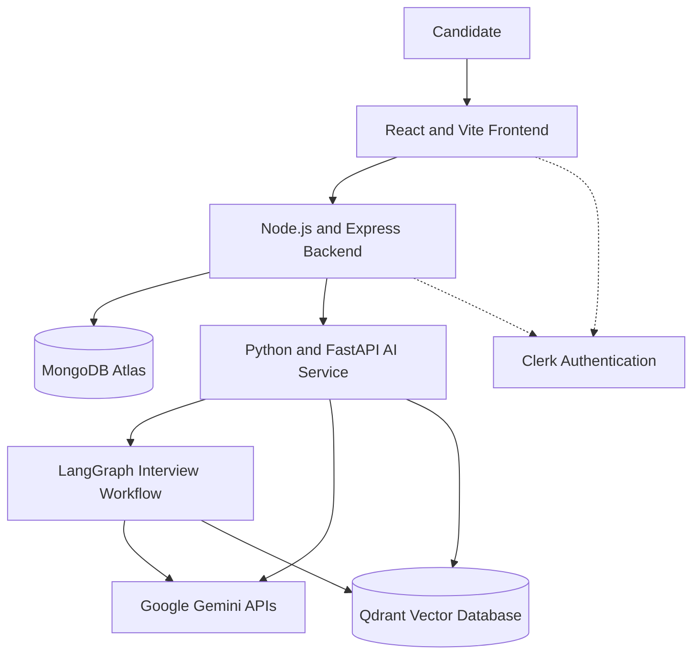
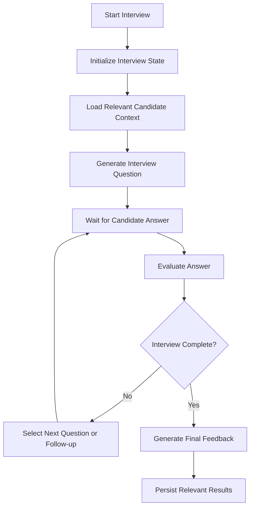
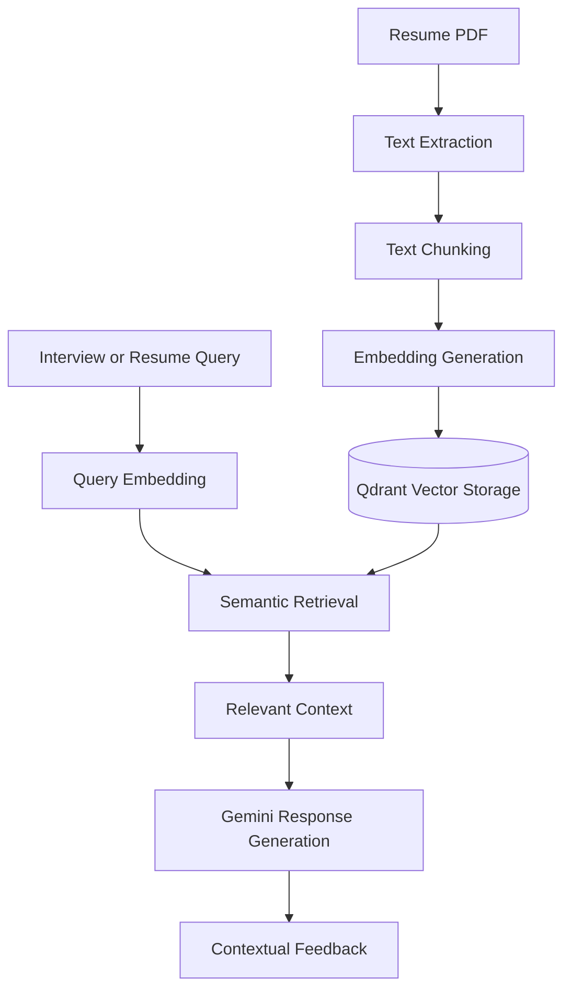

# 🚀 PrepAI 2.0 — AI-Powered Interview Preparation Platform

PrepAI 2.0 is a full-stack AI-powered platform designed to help software engineering candidates prepare for technical and behavioral interviews.

It combines coding practice, AI-assisted code evaluation, structured behavioral mock interviews, and resume-based contextual retrieval in one application.

The project has evolved from a traditional React and Node.js application into a multi-service architecture, with a dedicated Python AI service for AI workflows, LangGraph orchestration, and vector retrieval.

**The goal:** build an interview preparation platform that does more than generate AI responses — it maintains interview state, retrieves relevant candidate context, evaluates answers, and supports a more personalized preparation experience.

## Table of Contents

- [Features](#-features)
- [Architecture](#-architecture)
- [Technology Stack](#-technology-stack)
- [How It Works](#-how-it-works)
- [Engineering Decisions](#-engineering-decisions)
- [Repository Structure](#-repository-structure)
- [Getting Started](#-getting-started)
- [Environment Configuration](#-environment-configuration)
- [Testing](#-testing)
- [Deployment](#-deployment)
- [Security Considerations](#-security-considerations)
- [Current Status and Roadmap](#-current-status-and-roadmap)
- [Contributing](#-contributing)
- [Author and License](#-author-and-license)

---

## ✨ Features

### 1. DSA Arena

Practice data structures and algorithms through an interactive coding environment.

- Generate coding problems based on topics and difficulty.
- Write and edit code in a browser-based editor.
- Work with supported programming languages, including C++, Java, JavaScript, and Python, where enabled.
- Receive AI-assisted feedback on code correctness, complexity, edge cases, and possible improvements.
- Use problem validation and repair mechanisms to improve the reliability of generated challenges.
- Explore company-specific coding questions from a curated question catalog.
- Track coding progress and avoid repetitive practice where supported by the application.

The platform combines AI-generated content with validation logic instead of assuming every generated problem or solution is correct.

### 2. Behavioral Interview Coach

Practice behavioral interviews through a conversational AI coach.

- Conduct structured, multi-turn mock interviews.
- Answer questions based on your experience and projects.
- Receive feedback on your answers using the STAR framework:
  - Situation
  - Task
  - Action
  - Result
- Use candidate context to make interview questions more relevant.
- Maintain interview state across multiple stages.
- Evaluate answers and determine the next interview step.
- Generate a summary or final report when the interview workflow supports completion.

The interview workflow uses LangGraph to coordinate application logic and state transitions. Gemini provides the underlying language-model capabilities.

### 3. Resume Reviewer and Contextual RAG

Use resume information to support personalized feedback and interview preparation.

- Upload a resume in PDF format.
- Extract text and divide it into manageable chunks.
- Generate embeddings for semantic retrieval.
- Store and retrieve relevant vectors using Qdrant.
- Retrieve relevant resume information when constructing contextual AI responses.
- Connect candidate experience, projects, and technical skills to interview preparation.

The purpose of retrieval-augmented generation (RAG) is to provide the model with relevant source information rather than relying entirely on a generic prompt or sending an entire document on every request.

### 4. Contextual User Memory

PrepAI 2.0 is designed to support personalization across interview sessions.

Depending on the memory features enabled in the current implementation, useful context can include:

- Areas where a candidate needs improvement.
- Previous interview responses and evaluation results.
- Recurring technical weaknesses.
- Candidate skills, projects, and technology preferences.

The intended approach is to retrieve relevant, bounded context rather than inject every stored memory into every AI request.

### 5. Company-Specific DSA Question Catalog

PrepAI includes a company-specific question catalog based on public community-maintained datasets.

The catalog workflow includes:

- Importing question metadata from upstream repositories.
- Normalizing company aliases and problem URLs.
- Deduplicating questions.
- Storing catalog records in MongoDB.
- Retrieving relevant company questions through the backend.
- Maintaining synchronization history where configured.

Upstream sources:

- [leetcode-companywise-interview-questions](https://github.com/snehasishroy/leetcode-companywise-interview-questions)
- [leetcode-company-wise-problems](https://github.com/liquidslr/leetcode-company-wise-problems)

Please review each upstream repository's licensing and attribution requirements before redistributing its data.

---

## 🏗️ Architecture

PrepAI 2.0 separates the user interface, application backend, and AI workflows into distinct services.

| Component | Responsibility |
|---|---|
| React frontend | User interface, coding environment, interview experience, and client-side interactions |
| Node.js and Express | Application APIs, authentication integration, business logic, and database operations |
| Python and FastAPI | AI-related APIs, document processing, vector operations, and interview workflow integration |
| LangGraph | Interview state and workflow orchestration |
| Gemini | Language-model generation, evaluation, and embedding operations where configured |
| MongoDB Atlas | Application records and structured data |
| Qdrant | Vector storage and semantic retrieval |
| Clerk | Authentication and session management |

### High-level architecture



The diagram represents the logical architecture. The exact request path depends on the feature: for example, some application operations are handled by Node.js, while AI workflows are delegated to the Python service.

---

## 🧠 How It Works

### Behavioral interview workflow

LangGraph coordinates the interview workflow rather than replacing the language model or application backend.



At a high level, the workflow:

1. Initializes the interview session.
2. Retrieves relevant candidate information where configured.
3. Generates a question appropriate to the current stage.
4. Waits for the candidate's response.
5. Evaluates the answer and updates interview state.
6. Continues with another question or follow-up when appropriate.
7. Produces a final report when the interview is complete.

This separation makes interview progression easier to reason about than a single, unstructured prompt containing the entire conversation.

### Resume RAG pipeline



The general pipeline consists of:

1. Extracting text from the uploaded document.
2. Splitting the extracted content into chunks.
3. Generating vector embeddings.
4. Storing vectors with the metadata needed for retrieval.
5. Embedding a query and retrieving relevant chunks.
6. Passing the retrieved context to the model to help generate a grounded response.

The exact embedding model, chunk size, overlap, filtering strategy, and vector dimensions should match the current service configuration.

### Structured data versus vector data

MongoDB and Qdrant serve different purposes.

| MongoDB Atlas | Qdrant |
|---|---|
| Application and user records | Vector embeddings |
| Structured interview and progress data where implemented | Semantic similarity search |
| Resume metadata and document references where implemented | Chunk vectors and retrieval metadata |
| Catalog records and synchronization logs where configured | Vector collections and payload filters |

Keeping these responsibilities separate makes application data easier to manage while allowing the AI service to perform semantic retrieval.

---

## 🛠️ Engineering Decisions

### 1. Separate application logic from AI workflows

The Node.js backend remains responsible for application APIs and business logic. Python/FastAPI provides a dedicated environment for AI processing and orchestration.

This allows each service to evolve independently, but it also introduces network boundaries, service configuration, and additional failure modes.

### 2. Use LangGraph for workflow orchestration

Multi-stage interviews require explicit state, conditional transitions, and a way to continue after a candidate submits an answer.

LangGraph provides a graph-based approach to coordinating these steps. Gemini remains responsible for language generation and evaluation; LangGraph coordinates when those operations happen.

### 3. Retrieve relevant context instead of sending everything

RAG allows the system to retrieve relevant resume content or other supported knowledge before generating a response.

This can reduce unnecessary context and help ground responses in source material. Retrieval quality still depends on chunking, embeddings, filters, and the quality of the original document.

### 4. Keep structured application data separate from vector retrieval

MongoDB stores application data, while Qdrant handles vector search. This separation gives each storage system a clearer responsibility.

It also means the application must coordinate document identifiers, access control, updates, and cleanup across both systems.

### 5. Treat AI output as untrusted until validated

AI-generated coding problems and feedback can be incorrect. Validation, structured response handling, error handling, and tests help catch failures before they reach users.

Similarly, service-to-service requests need explicit timeouts and authentication, and upstream failures should be distinguishable from application errors.

---

## 💻 Technology Stack

### Frontend

- [React](https://react.dev/)
- [Vite](https://vite.dev/)
- [Tailwind CSS](https://tailwindcss.com/)
- [CodeMirror](https://github.com/uiwjs/react-codemirror)
- [Axios](https://axios-http.com/)
- [Clerk](https://clerk.com/)
- [Lucide](https://lucide.dev/)

### Application backend

- [Node.js](https://nodejs.org/)
- [Express](https://expressjs.com/)
- [MongoDB Atlas](https://www.mongodb.com/atlas)
- [Mongoose](https://mongoosejs.com/)
- [Google Gemini SDK for Node.js](https://www.npmjs.com/package/@google/generative-ai), where used by the existing backend

### AI service

- [Python](https://www.python.org/)
- [FastAPI](https://fastapi.tiangolo.com/)
- [Uvicorn](https://www.uvicorn.org/)
- [Google Gen AI SDK](https://googleapis.github.io/python-genai/)
- [LangGraph](https://docs.langchain.com/oss/python/langgraph/overview)
- [Qdrant](https://qdrant.tech/)
- [Pydantic](https://docs.pydantic.dev/)

### Testing and observability

The project includes frontend and backend test suites, with Python tests for the AI service. The exact commands and coverage depend on the current repository configuration.

---

## 📂 Repository Structure

The following is a high-level view of the project. Refer to the repository itself for the complete and current file tree.

```text
PrepAI/
├── .github/
│   └── workflows/
│       └── sync-company-questions.yml
├── client/
│   ├── public/
│   ├── src/
│   │   ├── components/
│   │   ├── context/
│   │   ├── pages/
│   │   └── utils/
│   ├── tests/
│   └── package.json
├── server/
│   ├── config/
│   ├── controllers/
│   ├── middleware/
│   ├── models/
│   ├── routes/
│   ├── scripts/
│   ├── services/
│   ├── tests/
│   └── package.json
├── ai-services/
│   ├── app/
│   │   ├── agents/
│   │   ├── core/
│   │   ├── routes/
│   │   ├── schemas/
│   │   └── services/
│   ├── tests/
│   └── requirements.txt
├── docker-compose.yml
└── README.md
```

Some directories or files may differ between branches. This tree is intended to explain the main service boundaries, not replace repository inspection.

---

## 🚀 Getting Started

### Prerequisites

Install the tools required by the services you intend to run:

- Node.js and npm.
- Python and `pip`.
- A MongoDB Atlas database or another supported MongoDB instance.
- A Qdrant Cloud cluster or a compatible local Qdrant instance.
- A Google Gemini API key.
- A Clerk application if authentication is enabled.
- Git.

Docker is useful if your local setup uses containerized dependencies.

### 1. Clone the repository

```bash
git clone <YOUR_GITHUB_REPOSITORY_URL>
cd PrepAI
```

Replace the placeholder with the actual repository URL.

### 2. Start the Python AI service

```bash
cd ai-services

python -m venv .venv
```

Activate the virtual environment.

**Windows PowerShell:**

```powershell
.\.venv\Scripts\Activate.ps1
```

**macOS/Linux:**

```bash
source .venv/bin/activate
```

Install the dependencies:

```bash
pip install -r requirements.txt
```

Configure the environment variables described in the service's `.env.example`, if provided.

Start the service using the project's configured entry point. The previously used local command is:

```bash
uvicorn app.main:app --reload --port 9000
```

If the application uses a health endpoint, verify it at the corresponding local URL.

### 3. Start the Node.js backend

Open a separate terminal:

```bash
cd server
npm install
```

Configure the backend environment variables using the provided example configuration.

Start the backend using the development script defined in `server/package.json`. For example, if the project defines `dev`:

```bash
npm run dev
```

The backend has commonly used port `5000` in local development. Confirm the actual port from the configuration and startup logs.

### 4. Start the React frontend

Open another terminal:

```bash
cd client
npm install
npm run dev
```

Vite has commonly used port `5173` for this project.

Open the URL printed by Vite, typically:

```text
http://localhost:5173
```

### Local development notes

- Ensure the frontend API base URL points to the local Node.js backend.
- Ensure the Node.js backend points to the local Python AI service.
- Configure matching service authentication secrets where required.
- Ensure MongoDB, Qdrant, and Gemini configuration is valid before testing dependent features.
- If a service fails to start, inspect its logs before changing configuration or code.

The exact scripts, ports, and required environment variables must match the current branch.

---

## 🔐 Environment Configuration

Never commit real credentials, API keys, database connection strings, or service secrets.

Use the example configuration files supplied with the project. The following table lists variables discussed during development; verify the actual names and requirements against each service's configuration before using them.

| Variable | Service | Purpose |
|---|---|---|
| `VITE_CLERK_PUBLISHABLE_KEY` | Frontend | Public Clerk publishable key, if used by the current client |
| `VITE_API_BASE_URL` | Frontend | Base URL for the Node.js API, if configured |
| `VITE_POSTHOG_KEY` | Frontend | Optional analytics project key |
| `VITE_POSTHOG_HOST` | Frontend | Analytics ingestion host |
| `CLERK_SECRET_KEY` | Backend | Private Clerk server credential |
| `DATABASE_URL` or `MONGODB_URI` | Backend | MongoDB connection string; use the name actually read by the application |
| `AI_SERVICE_URL` | Backend | Base URL for the Python AI service |
| `AI_SERVICE_SECRET` | Backend and AI service | Shared service-to-service authentication secret |
| `AI_SERVICE_TIMEOUT_MS` | Backend | Timeout for AI-service requests, if supported |
| `GEMINI_API_KEY` | Backend or AI service | Gemini API credential for the operations handled by that service |
| `QDRANT_URL` | AI service | Qdrant endpoint |
| `QDRANT_API_KEY` | AI service | Qdrant authentication credential when required |
| `QDRANT_COLLECTION` | AI service | Vector collection name, if configurable |
| `LANGSMITH_TRACING` | AI service | Optional LangSmith tracing setting, if integrated |

### Configuration guidelines

- Frontend variables prefixed with `VITE_` are exposed in the browser bundle. They must never contain private secrets.
- Backend and AI-service credentials must remain server-side.
- If both services use `AI_SERVICE_SECRET`, their configured values must match.
- Use HTTPS for deployed service endpoints.
- Avoid logging credentials or full authentication headers.
- Check `.env.example` files and configuration code to establish which variables are mandatory.

Do not copy example placeholders into a real deployment without replacing them with valid configuration values.

---

## 🧪 Testing

Run the tests defined by each service's current configuration.

### Frontend

```bash
cd client
npm test
```

Build the production bundle:

```bash
npm run build
```

### Node.js backend

```bash
cd server
node tests/run-all-tests.js
```

Use this command if `tests/run-all-tests.js` exists in the current branch. Otherwise, follow the scripts defined in `server/package.json`.

### Python AI service

Activate the Python virtual environment, then run the test command supported by the repository.

For a project using `unittest`:

```bash
python -m unittest discover tests
```

For a project configured for `pytest`:

```bash
pytest tests/
```

Use the test framework actually configured by the current branch.

### What to verify

- Frontend rendering and navigation.
- Backend API behavior and error handling.
- Authentication and service-to-service requests.
- Interview workflow transitions.
- Resume processing and retrieval.
- Vector collection configuration and retrieval filters.
- AI failure handling and timeout behavior.

A successful unit test or build does not automatically verify the complete deployed system. End-to-end behavior should be tested separately.

---

## 🌐 Deployment

The previously configured deployment topology uses:

| Service | Platform |
|---|---|
| React frontend | Vercel |
| Node.js backend | Render |
| Python AI service | Render |
| Application database | MongoDB Atlas |
| Vector database | Qdrant Cloud |

Previously used deployment addresses:

- Frontend: https://prepai-app.vercel.app/
- Node.js backend: https://prepai-backend-rj08.onrender.com
- Python AI service: https://prepai-ai-service-meda.onrender.com

These URLs are historical project configuration and should be checked before relying on them.

### Deployment checklist

1. Configure frontend, backend, and AI-service environment variables independently.
2. Verify that frontend API requests target the correct backend.
3. Verify that the backend targets the correct AI service.
4. Configure matching internal service authentication secrets.
5. Confirm database connectivity and vector collection configuration.
6. Verify health endpoints where implemented.
7. Test the interview, resume, and coding workflows after deployment.
8. Inspect service logs for timeouts, authentication failures, and upstream AI errors.

---

## 🛡️ Security Considerations

Security must be enforced by the implementation, not merely described in documentation.

- Keep private API keys and database credentials out of source control.
- Do not expose backend-only secrets through frontend environment variables.
- Authenticate application requests using the configured authentication system.
- Protect internal service requests using the configured authentication mechanism.
- Validate uploaded documents and request payloads.
- Apply appropriate access controls to candidate data and resume content.
- Keep hidden coding test cases on the server side.
- Avoid logging sensitive candidate information or authentication credentials.
- Use timeouts and explicit error handling for upstream service calls.
- Treat AI-generated answers, code, and evaluations as fallible outputs.

These are important design and maintenance requirements; their actual enforcement depends on the current implementation and deployment configuration.

---

## 📈 Current Status and Roadmap

PrepAI 2.0 is an evolving project.

### Areas of development

- Multi-service application architecture.
- Stateful behavioral interview orchestration.
- Resume processing and vector-based retrieval.
- Personalized interview context and memory.
- AI-generated coding challenges and evaluation.
- Company-specific DSA question catalog.
- Error handling, regression tests, and deployment reliability.

### Potential future improvements

The following are ideas rather than claims of completed functionality:

- More comprehensive interview analytics and progress tracking.
- Better retrieval evaluation and context-quality measurements.
- Improved end-to-end testing across all three services.
- More advanced voice-based interview interactions.
- System design interview practice.
- Additional evaluation benchmarks for generated problems and feedback.

The roadmap may change as implementation and testing progress.

---

## 🤝 Contributing

Contributions, bug reports, and constructive feedback are welcome.

### Getting started

1. Fork the repository.
2. Create a feature branch:

   ```bash
   git checkout -b feature/your-feature-name
   ```

3. Make a focused change.
4. Run the relevant tests and build checks.
5. Confirm that no credentials or `.env` files are included.
6. Commit your changes with a clear message.
7. Open a pull request explaining the problem, the solution, and how it was tested.

### Contribution guidelines

- Keep changes focused and easy to review.
- Preserve existing API contracts unless a change is intentional and documented.
- Coordinate changes that affect communication between the Node.js and Python services.
- Include regression tests for bug fixes where practical.
- Document non-obvious architectural decisions.
- Never commit secrets or private candidate data.

For bugs, include reproduction steps, expected behavior, actual behavior, and relevant sanitized logs.

---

## 👤 Author

Developed by **Aman Rawat** as a hands-on project exploring full-stack development, AI integration, retrieval-augmented generation, and stateful AI workflows.

PrepAI is both an interview preparation product and an ongoing engineering project focused on understanding how application services, data retrieval, and AI orchestration fit together.


---

⭐ If you find PrepAI interesting, consider starring the repository or contributing feedback.
