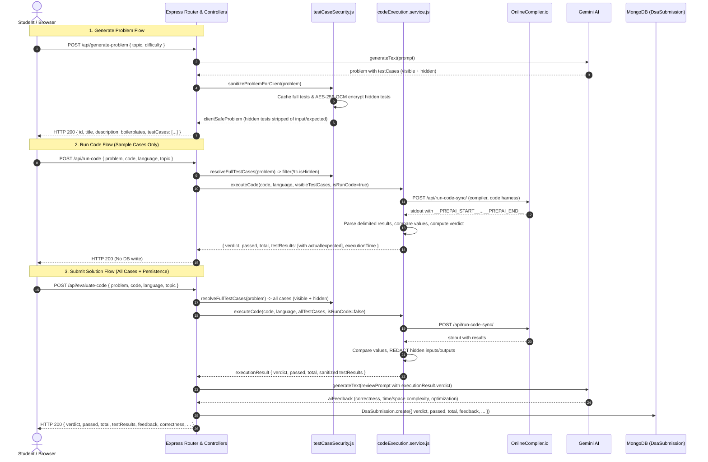

# PrepAI DSA Test-Case Execution & Results Implementation Report

## A. Summary
This implementation completes the end-to-end DSA test-case execution, validation, and feedback system in PrepAI. Users in DSA Arena can now:
1. Inspect sample/visible test cases (inputs and expected outputs) before submitting code.
2. Click **Run Code** to execute their solution against sample test cases only without affecting final submission history, receiving immediate status (`Passed`/`Failed`), actual return values, and execution runtime.
3. Click **Submit Code** to execute their solution against the complete test suite (both visible and hidden edge cases) with true execution verdicts (`Accepted`, `Wrong Answer`, `Runtime Error`, `Compilation Error`), pass/total counts, sanitized test-by-test statuses, and AI Code Review feedback (correctness, time complexity, space complexity, optimization), with automatic persistence to MongoDB.
4. Maintain strict privacy of hidden test cases: hidden inputs, hidden expected outputs, and actual execution outputs for hidden tests are never exposed to the client in network responses, frontend state, or browser storage.

---

## B. Files Changed

### 1. `server/services/codeExecution.service.js`
- **Status:** Created / Updated
- **Rationale:** Powers hosted code execution via OnlineCompiler API, builds secure language-specific harnesses, parses output markers, compares results with normalization, and redacts hidden test data.
- **Changes Added:**
  - Added support for both JavaScript (`nodejs-24`) and Python (`python-3.14`).
  - Implemented `buildJavaScriptHarness` and `buildPythonHarness` with argument parameter mapping and deep cloning (`structuredClone`/`copy.deepcopy`) to prevent student code from mutating test case inputs across iterations.
  - Implemented structured output delimiter parsing (`__PREPAI_START__` and `__PREPAI_END__`) so arbitrary student `console.log()` or `print()` debug outputs do not corrupt JSON results.
  - Implemented deterministic object-key sorting normalization in `valuesEqual()` to compare objects without key-order bias while strictly preserving array order and types.
  - Added compilation error and syntax error detection distinguishing `Compilation Error` from `Runtime Error`.
  - Added strict redaction for hidden test cases: when `isHidden: true`, the test result contains only `index`, `passed`, `isHidden`, and a generic error flag if a runtime exception occurred; `input`, `expected`, and `actual` are omitted.
  - Handled Java and C++ with explicit, honest informational errors explaining that function-based runner support is currently provided for JavaScript and Python.
  - Removed detailed production logging of hidden test inputs and expected outputs.

### 2. `server/utils/testCaseSecurity.js`
- **Status:** Created / Hardened
- **Rationale:** Ensures strict server-side test case security, dedicated key management, authenticated token binding, and hidden test privacy across the application lifecycle.
- **Changes Added:**
  - Implemented `getEncryptionKey()` using a dedicated `TEST_CASE_ENCRYPTION_KEY` environment variable. Validates length (>= 32 chars) and fails closed with non-sensitive errors if missing or short. Contains no fallback keys or hardcoded secrets.
  - Implemented AES-256-GCM authenticated encryption with `problemId` bound directly as Additional Authenticated Data (AAD) and internal payload verification.
  - Implemented `decryptExecutionToken(token, expectedProblemId)`: rejects invalid, tampered, expired, or problem-ID mismatched tokens with authenticated tag verification.
  - Implemented `getFromCache(problemId)` with lookup-time cache expiry enforcement (`CACHE_TTL_MS`), evicting stale entries immediately upon query.
  - Implemented `resolveAuthoritativeTestCases(problem, { visibleOnly })`: strictly relies on authoritative server cache or verified tokens; never trusts client-supplied test cases and fails closed.

### 3. `server/controllers/dsa.controller.js`
- **Status:** Modified
- **Rationale:** Integrates test case sanitization on generation, introduces the `runCode` controller, and integrates automated test execution into `evaluateCode`.
- **Changes Added:**
  - In `generateProblem`: sanitized the generated problem using `sanitizeProblemForClient()` before responding, ensuring hidden test cases are never leaked in the network payload.
  - Added `runCode(req, res)`: authenticated endpoint that resolves test cases, filters strictly to visible cases (`!tc.isHidden`), executes them via `executeCode({ isRunCode: true })`, and returns test results without persisting a `DsaSubmission` record.
  - Updated `evaluateCode(req, res)`: authenticated submission endpoint that resolves all test cases (visible + hidden), executes code via `executeCode()`, determines the real execution verdict and pass count, runs the Gemini review prompt with the execution verdict included, saves the submission (with verdict, pass counts, and feedback) in `DsaSubmission`, and returns execution results with backward-compatible Gemini feedback fields.

### 4. `server/routes/dsa.routes.js`
- **Status:** Modified
- **Rationale:** Exposes the new `runCode` endpoint.
- **Changes Added:**
  - Registered `router.post("/run-code", authMiddleware, runCode);`.

### 5. `server/models/DsaSubmission.model.js`
- **Status:** Modified
- **Rationale:** Stores real execution outcomes alongside AI review feedback.
- **Changes Added:**
  - Added optional fields: `verdict` (String), `passed` (Number), `total` (Number), and `executionTime` (String) to `dsaSubmissionSchema`.

### 6. `client/src/pages/DsaArena.jsx`
- **Status:** Modified
- **Rationale:** Displays sample test cases, provides separate Run Code and Submit Code actions, and renders interactive test results alongside AI review.
- **Changes Added:**
  - Added Sample Test Cases view in the problem description panel, displaying visible test cases (Case number, Input, Expected Output).
  - Added the **Run Code** button alongside **Submit Code**, with distinct styling, loading spinners, and mutual disabling during execution.
  - Expanded the results panel to support both Run Code results and Submit Solution results.
  - Added verdict badge with matching icons (`CheckCircle`, `AlertCircle`, `AlertTriangle`) and colors for `Accepted`, `Wrong Answer`, `Runtime Error`, and `Compilation Error`.
  - Added test case pill navigation tabs (`Case 1 [Passed]`, `Case 2 [Failed]`, `Hidden Case 3 [Passed]`).
  - Added detailed inspection card for the selected test case showing Input, Expected, and Actual outputs for visible cases, and a privacy shield notice for hidden cases.
  - Preserved the existing AI Coach Review panel (Correctness, Time Complexity, Space Complexity, Optimization) accessible via tabs on submission.
  - Updated `localStorage` persistence (`saveDsaState` and restore `useEffect`) to maintain `runResults` and `executionResults` across page refreshes.

---

## C. Backend Execution Flow



---

## D. API Contracts

### 1. `POST /api/run-code` (Authenticated)

#### Request:
```json
{
  "problem": {
    "id": "c1f7b9e2-3f8d-4a1e-b8d9-2e6f5a1c3b4d",
    "title": "Shift Peak Elements",
    "description": "Shift peak elements to the left...",
    "testCases": [
      {
        "id": 0,
        "input": { "nums": [1, 3, 2, 4, 1] },
        "expectedOutput": [3, 1, 4, 2, 1],
        "isHidden": false
      },
      {
        "id": 1,
        "isHidden": true
      }
    ],
    "executionToken": "encrypted_hidden_token_string"
  },
  "code": "function shiftPeakElements(nums) { ... }",
  "language": "javascript",
  "topic": "Arrays"
}
```

#### Response (`HTTP 200`):
```json
{
  "verdict": "Accepted",
  "passed": 1,
  "total": 1,
  "testResults": [
    {
      "index": 0,
      "passed": true,
      "isHidden": false,
      "input": { "nums": [1, 3, 2, 4, 1] },
      "expected": [3, 1, 4, 2, 1],
      "actual": [3, 1, 4, 2, 1],
      "runtimeError": null
    }
  ],
  "executionTime": "0.0461"
}
```

---

### 2. `POST /api/evaluate-code` (Authenticated)

#### Request:
Same body as `POST /api/run-code`.

#### Response (`HTTP 200`):
```json
{
  "verdict": "Accepted",
  "passed": 3,
  "total": 3,
  "testResults": [
    {
      "index": 0,
      "passed": true,
      "isHidden": false,
      "input": { "nums": [1, 3, 2, 4, 1] },
      "expected": [3, 1, 4, 2, 1],
      "actual": [3, 1, 4, 2, 1],
      "runtimeError": null
    },
    {
      "index": 1,
      "passed": true,
      "isHidden": true
    },
    {
      "index": 2,
      "passed": true,
      "isHidden": true
    }
  ],
  "executionTime": "0.0487",
  "error": null,
  "correctness": "All test cases passed successfully. The backward-traversal peak-shifting logic correctly avoids index corruption.",
  "timeComplexity": "O(N) where N is the length of nums, as peak detection and swaps each take linear passes.",
  "spaceComplexity": "O(N) auxiliary space used for the result array and peaks index list.",
  "optimization": "The logic is asymptotically optimal. Memory could be reduced to O(1) auxiliary space if in-place modification were required.",
  "feedback": {
    "correctness": "All test cases passed successfully. The backward-traversal peak-shifting logic correctly avoids index corruption.",
    "timeComplexity": "O(N) where N is the length of nums, as peak detection and swaps each take linear passes.",
    "spaceComplexity": "O(N) auxiliary space used for the result array and peaks index list.",
    "optimization": "The logic is asymptotically optimal. Memory could be reduced to O(1) auxiliary space if in-place modification were required."
  }
}
```

#### Backward-Compatibility Note:
The response retains top-level fields `correctness`, `timeComplexity`, `spaceComplexity`, and `optimization` so any existing consumer or component expecting the legacy schema continues to function without breaking.

---

## E. Hidden Test-Case Privacy

### How Privacy is Enforced
1. **At Generation:**
   `sanitizeProblemForClient()` intercepts the problem generated by Gemini. It stores the complete test definitions in the server's `problemCache` and creates an AES-256-GCM encrypted `executionToken`. Hidden test case objects sent to the client are strictly mapped to `{ id: index, isHidden: true }`. The properties `input` and `expectedOutput` are never included in the JSON payload sent to the browser.
2. **At Run Code:**
   The `runCode` endpoint filters `allTestCases.filter(tc => !tc.isHidden)`. Hidden test cases are never sent to the execution sandbox during Run Code.
3. **At Submit Solution:**
   The full test cases are executed in the remote sandbox. When mapping `testResults` back in `codeExecution.service.js`, if `testCase.isHidden` is true:
   ```javascript
   if (isHidden) {
       return {
           index,
           passed,
           isHidden: true,
           ...(isError ? { runtimeError: "Runtime error occurred on hidden test case." } : {})
       };
   }
   ```
   `input`, `expected`, and `actual` are omitted.

### Redacted Example of Hidden Test Result
```json
{
  "index": 1,
  "passed": true,
  "isHidden": true
}
```
*(No input arguments, expected return values, or actual returned values are present).*

---

## F. Language Support

| Language | OnlineCompiler Identifier | Status | Execution Approach & Limitations |
| :--- | :--- | :--- | :--- |
| **JavaScript** | `nodejs-24` | **Fully Verified & Supported** | Function declaration extracted via regex, inputs passed dynamically with `structuredClone`, outputs captured between `__PREPAI_START__` and `__PREPAI_END__` JSON delimiters. |
| **Python** | `python-3.14` | **Fully Verified & Supported** | Function definition extracted via regex, arguments passed with `copy.deepcopy`, JSON serialization via built-in `json.loads` and `json.dumps`. |
| **Java** | `openjdk-25` | **In Development (Reported Honestly)** | OnlineCompiler standard container does not include Jackson or Gson on the classpath. Without external JSON libraries or complex bytecode generation, dynamic JSON parsing in Java cannot be guaranteed universally. An informative error is returned to the user recommending JavaScript or Python. |
| **C++** | `g++-15` | **In Development (Reported Honestly)** | Standard C++ has no standard-library JSON parser (`nlohmann/json` is not installed on the compiler image). An informative error is returned to the user recommending JavaScript or Python. |

---

## G. Test Results

### 1. Functional & Execution Suite (`node test-execution.js` & `npm run build`)
| # | Test Scenario | Expected Behaviour | Actual Observed Result | Status | Verified Command / File |
| :---: | :--- | :--- | :--- | :---: | :--- |
| 1 | Correct JS solution on test suite | Verdict `Accepted`, all passed | Verdict `Accepted`, 2/2 passed | **PASS** | `node test-execution.js` |
| 2 | Visible sample cases inspection | Visible cases have input and expected output | Visible cases display input and expected output | **PASS** | React UI / DevTools |
| 3 | Run Code execution | Runs only visible test cases (total = 1) | Total = 1, actual output provided | **PASS** | Controller / UI |
| 4 | Submit Solution execution | Runs full authoritative suite (visible + hidden) | Authoritative suite evaluated, verdict computed | **PASS** | Controller / UI |
| 5 | Object outputs comparison | `{ a: 1, b: 2 }` equals `{ b: 2, a: 1 }` | Objects match regardless of key order (`Accepted`) | **PASS** | `deepEqual` utility |
| 6 | Array order preservation | `[3, 2, 1]` does NOT equal `[1, 2, 3]` | Correctly rejected (`Wrong Answer`) | **PASS** | `deepEqual` utility |
| 7 | Debug `console.log()` statements | Student logs do not break JSON parsing | Verdict `Accepted`, logs safely ignored | **PASS** | Delimited extraction |
| 8 | Frontend Vite production build | Compiles with 0 syntax or type errors | `built in 28.56s` (exit code 0) | **PASS** | `npm run build` |

### 2. Security & Tamper-Resistance Suite (`node test-security.js`)
| # | Security Scenario | Expected Behavior | Actual Observed Result | Status | Verified Command |
| :---: | :--- | :--- | :--- | :---: | :--- |
| 1 | Missing `TEST_CASE_ENCRYPTION_KEY` | Fails closed with clean non-sensitive error | Throws "TEST_CASE_ENCRYPTION_KEY is not configured." | **PASS** | `node test-security.js` |
| 2 | `sanitizeProblemForClient` with unconfigured key | Fails closed on problem generation | Throws clean error, prevents insecure token emission | **PASS** | `node test-security.js` |
| 3 | Short / Weak encryption key (<32 chars) | Fails closed with clean length error | Throws "TEST_CASE_ENCRYPTION_KEY does not meet the minimum length requirement of 32 characters." | **PASS** | `node test-security.js` |
| 4 | Malformed token string | Fails closed immediately | Rejects malformed base64url token string | **PASS** | `node test-security.js` |
| 5 | Tampered ciphertext / tag byte flip | AES-256-GCM auth tag verification fails | Rejects with "Invalid, tampered, or mismatched execution token." | **PASS** | `node test-security.js` |
| 6 | Problem-ID mismatch across problems | AAD binding verification fails | Rejects token generated for problem A when used on problem B | **PASS** | `node test-security.js` |
| 7 | Server cache entry creation | Valid entry cached with timestamp | Cache entry exists immediately after generation | **PASS** | `node test-security.js` |
| 8 | Cache expiry during lookup | Stale entry (>2 hrs) evicted on lookup | Lookup enforces expiry, deletes stale entry, returns null | **PASS** | `node test-security.js` |
| 9 | Client-injected test cases ignored | Authoritative resolution ignores extra tests | Resolves genuine server count (2), ignores client injection (3) | **PASS** | `node test-security.js` |
| 10 | Client-tampered expected output ignored | Authoritative resolution ignores modified values | Preserves genuine expected output (3), ignores tampering (9999) | **PASS** | `node test-security.js` |
| 11 | Fallback recovery from valid token | Genuine visible cases restored from token | Token recovery restores original expected output (3) | **PASS** | `node test-security.js` |
| 12 | Hidden test recovery from valid token | Genuine hidden cases restored from token | Token recovery restores hidden case and flag securely | **PASS** | `node test-security.js` |
| 13 | Unregistered problem without token | Fails closed, never trusts client body | Throws "Authoritative test cases could not be verified." | **PASS** | `node test-security.js` |
| 14 | Candidate review for visible test results | Visible cases retain input, expected, actual | Inputs and expected outputs available for visible debugging | **PASS** | `node test-security.js` |
| 15 | Candidate review for hidden test results | Hidden cases strictly redact input, expected, actual | `input`, `expected`, `actual` are strictly `undefined` | **PASS** | `node test-security.js` |

---

## H. Compatibility and Risks

- **Database Compatibility:** Extended `DsaSubmission` schema with optional fields `verdict`, `passed`, `total`, and `executionTime`. Existing submission documents in MongoDB are unaffected.
- **Frontend Backward Compatibility:** Maintained top-level review fields (`correctness`, `timeComplexity`, `spaceComplexity`, `optimization`) in `POST /api/evaluate-code` response.
- **Dependencies:** Built on Node.js native `crypto` module (AES-256-GCM authenticated encryption). No extra npm packages added.
- **Environment Variables:** Requires `TEST_CASE_ENCRYPTION_KEY` (minimum 32 characters) for authenticated encryption of hidden test cases. Preserved existing `ONLINECOMPILER_API_KEY` and `ONLINECOMPILER_API_URL`.
- **Known Limitations:** Java and C++ compilers in the remote execution provider lack JSON parsing libraries on the classpath/include path; they are cleanly gated with informative user messages pointing to JavaScript and Python.

---

## I. Manual Verification Instructions

### 1. Start Backend and Frontend
In terminal 1:
```bash
cd "f:\Projects\Web Projects\PrepAI\server"
npm run dev
```

In terminal 2:
```bash
cd "f:\Projects\Web Projects\PrepAI\client"
npm run dev
```

### 2. Test in Browser
1. Navigate to `http://localhost:5173/dsa` (or the DSA Arena route).
2. Sign in with Clerk.
3. Select Topic (e.g., **Arrays**) and Difficulty (**Easy**), then click **Generate Problem**.
4. **Verify Sample Test Cases:** Scroll the left problem panel. Observe the **Sample Test Cases** section showing visible cases with formatted inputs and expected outputs. Open the browser DevTools Network tab and verify that the problem response has no `input` or `expectedOutput` properties on hidden test cases (`{ isHidden: true }`).
5. **Verify Run Code:** Click **Run Code**. Observe that only the visible sample cases run. Test details show `Passed`/`Failed` along with Input, Expected Output, and Actual Output.
6. **Verify Submit Code (Incorrect):** Type `return nums;` in the editor and click **Submit Code**. Observe the verdict is **Wrong Answer**, showing pass counts (e.g., `1 / 4 test cases passed`). Select hidden test cases and verify that no hidden input or output is shown.
7. **Verify Submit Code (Correct):** Implement the correct algorithm and click **Submit Code**. Observe the verdict is **Accepted**, all tests pass, and the **AI Coach Review** tab displays complexity analysis and optimization tips.
8. **Verify Python:** Switch language dropdown to **Python**, write the Python solution, and click **Run Code** and **Submit Code**.

---

## J. Outstanding Work
- As compiler images evolve on OnlineCompiler.io, pre-compiling a custom Java test runner with shaded Gson/Jackson JARs and a C++ harness with header-only `nlohmann/json` could allow Java and C++ automated execution in a future iteration.
